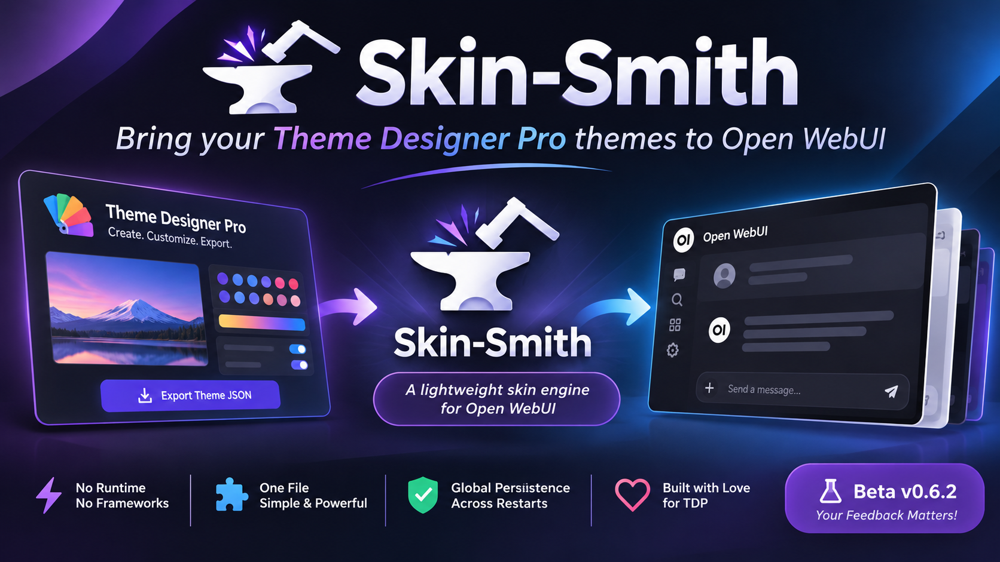

## Skin-Smith

**A lightweight skin engine for Open WebUI.** Feed it any [Theme Designer Pro](https://github.com/silentoplayz/theme-designer-pro-presets) theme JSON and Skin-Smith converts that theme into Open WebUI Custom CSS — applied cleanly for every user, persisted across restarts, from a single readable, self-contained function file. Keep your themes in the built-in library and switch between them anytime. No server, no frameworks, no runtime — and **no theme baked into the file**: the themes come from TDP's JSON, a source many of us already know and love.

> **Beta (v0.8.4).** Now supports **Open WebUI 0.11.0+**. New in this line: a **Theme Manager** — save up to 12 themes in a library, pick and apply any of them, all **persisted across Open WebUI restarts**; a **security update** (every state endpoint is admin-gated server-side, with token-revocation checks); and a full **UI/UX overhaul** of the `/skin` page. The conversion engine is proven; please report issues.

## What it is

- **One file, one function.** `skin-smith.py` is the entire extension: a self-contained Open WebUI Event-function loader. It is identical for every theme — no CSS embedded, no valve, no logging.
- **An engine, not a theme pack.** Skin-Smith takes what TDP produces from a theme JSON (palette, accents, manual overrides, gradient, custom CSS) and loads it as Open WebUI Custom CSS — that's all it does. Skin-Smith is the engine; TDP is the paint.
- **A theme manager on top of the engine.** A 12-slot library lives in the function meta: save, name, switch, update, delete — and the library **and** the applied theme survive Open WebUI restarts. Themes still come from TDP's JSON, never baked into the file.
- **Every line of palette, accent, and gradient math is ported verbatim** from the Theme Designer Pro team's official code, with respect and gratitude to them. We ship no CSS library of our own — the one exception is an Indigo sample draft that lights up the preview generator.

## What it is not

- Not a full TDP extension. TDP's runtime (SSE, Web Workers, Canvas FX, fonts, scripts) is deliberately **not** replicated — Skin-Smith delivers the CSS result.
- Not a theme collection. Make your theme in the [TDP Studio](https://silentoplayz.github.io/theme-designer-pro-presets/studio/), export the JSON, and Skin-Smith brings it to life.

**🎨 Theme Designer Pro Studio → https://silentoplayz.github.io/theme-designer-pro-presets/studio/**

## Requirements

- **Open WebUI ≥ 0.11.0**
- **SQLite** and **PostgreSQL** — persistence confirmed in the field on both (PostgreSQL on a live Postgres-backed Open WebUI, SQLite on a SQLite install).

## Install (manual)

1. Get the file:

   ```
   git clone https://github.com/xWaLeEdOoOx/skin-smith.git
   ```

   (or just download `skin-smith.py` from the repo)

2. In Open WebUI: right-click your username → **Admin Panel → Functions** → **Create** → paste the full contents of `skin-smith.py` → **Set as EVENT not Filter** → **Save**.

3. Open `http://<open-webui host>/skin` — Skin-Smith's converter page is live.

## Use

1. Make your theme in the [TDP Studio](https://silentoplayz.github.io/theme-designer-pro-presets/studio/) and export its JSON.
2. Sign in as an **admin** and open `http://<open-webui host>/skin`.
3. **Theme Manager:** name the theme and hit **Save as new** — it lands in the library (up to 12). Pick any saved theme from the dropdown to load it back, **Update slot** to overwrite, **Delete slot** to remove. The library **and** the applied theme are persisted across Open WebUI restarts.
4. Paste/upload the JSON (or hit **Load sample**), switch Dark / Light / OLED / Her to preview it live.
5. **Apply & Save** — the CSS is served as `/static/custom.css` for all users, persisted across restarts (function meta, with a direct DB fallback for builds where the functions model module is broken). Requires an **admin session**. **Restore default** clears it back to Open WebUI's own default.

## Running Skin-Smith together with Theme Designer Pro

Running Skin-Smith **and** Theme Designer Pro at the same time is redundant: both inject theme CSS, and the two effects can stack or conflict. We made our best effort to comply with TDP's shared-asset coexistence contract (their registry, their route, composed by order), and coexistence is technically safe — but for a clean result, **use one or the other**. Skin-Smith is built for people who want to run the TDP theme engine as lightly as possible — especially on older machines.

## Files in this repo

| File | Purpose |
|------|---------|
| `skin-smith.py` | The entire extension. Paste into Open WebUI → Functions. |
| `LICENSE` | Theme Designer Pro's MIT License — the palette/gradient math and the shared-asset registry contract are ported verbatim from TDP, (c) 2026 silentoplayz. The MIT notice is also embedded in `skin-smith.py`. |
| `OI-README.md` | The Open WebUI community post copy. |
| `assets/cover.png` | The README cover image. |

## Links

- **This repo:** https://github.com/xWaLeEdOoOx/skin-smith
- **Theme Designer Pro:** https://github.com/silentoplayz/theme-designer-pro-presets
- **TDP Studio (make your theme):** https://silentoplayz.github.io/theme-designer-pro-presets/studio/
- **Open WebUI:** https://github.com/open-webui/open-webui

*Skin-Smith: Made by Waleed Kh. Tolbah (AKA xWaLeEdOoOx), released with respect and gratitude to the Theme Designer Pro team and Open-WebUI for their great efforts and amazing work*

*Portions of Skin-Smith are based on or inspired by Theme Designer Pro by @G30 / silentoplayz. Used and adapted with permission under the MIT License.*
